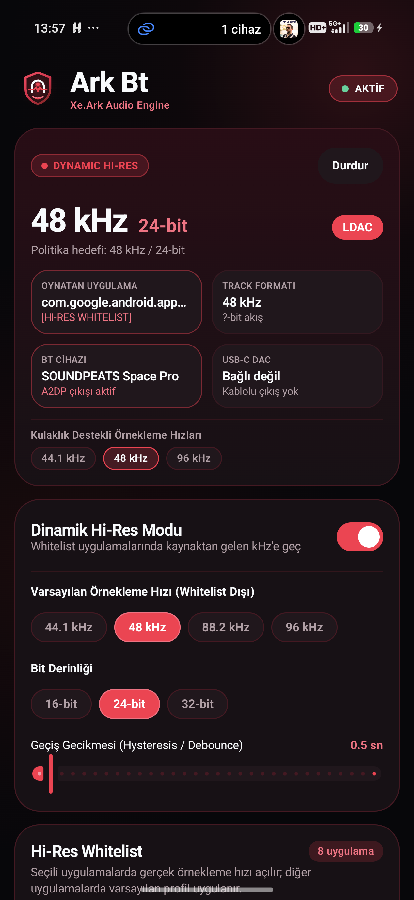

# Ark Bt 🎧⚡

<p align="center">
  
</p>

<p align="center">
  <strong>Dynamic Bluetooth Audio & High-Resolution Codec Controller for Android / HyperOS</strong><br>
  <em>Part of the Xe.Ark Custom ROM Ecosystem</em>
</p>

<p align="center">
  
  
  
  
</p>

---

## 🌟 Overview

**Ark Bt** is a high-performance system utility developed for the **Xe.Ark** ROM project (specifically optimized for POCO X8 Pro / MTK MT6899 and modern HyperOS environments). It dynamically monitors connected Bluetooth audio devices and applies audiophile-grade Bluetooth configurations:

- **Ultra-High Definition Codecs**: Full support for LDAC (96 kHz / 32-bit float, 990 kbps high-quality), SBC XQ (Dual Channel 552 kbps), aptX HD, and AAC.
- **Dynamic Policy Enforcement**: Real-time broadcast receiver tracking Bluetooth state transitions and applying optimal bitrates without manual toggling.
- **Material 3 Expressive UI**: Sleek, immersive Crimson-Black (`#990000` / `#0D0D11`) UI tailored for Xe.Ark branding.
- **Fluid 120 Hz Display**: Native 120 Hz refresh rate enforcement (`preferredRefreshRate` & `View.REQUESTED_FRAME_RATE_CATEGORY_HIGH`), zeroing out scroll micro-stutter (jank < 0.05%).
- **Low Footprint System Service**: Efficient state-signature deduplication eliminating redundant broadcast wakes.

---

## 📱 Screenshots

<p align="center">
  
</p>

---

## 🏗️ Architecture

```
dynamic_bt_rom/
├── app/                      # Android Application (Kotlin, Jetpack Compose, Material 3)
│   ├── src/main/java/com/emre/dynamicbt/
│   │   ├── core/             # Background services, BT broadcast receivers & codec switchers
│   │   └── ui/               # Material 3 Expressive composables & 120Hz window setup
│   └── src/main/res/         # Adaptive launcher icons, Xe.Ark vectors & themes
├── brand_assets/             # Master Xe.Ark / Ark Bt vector logo and high-res PNGs
├── docs/                     # Architecture documentation, dumps, and benchmark notes
├── rom_overlay/              # System partition overlay for ROM builders
│   └── system_ext/           # priv-app permissions, sysconfig & audio policy configs
└── tools/                    # Verification scripts & Phase test runners
```

---

## ⚙️ Building from Source

### Prerequisites
- JDK 17+ or JDK 21
- Android SDK (API Level 35+)

### Build APK
```bash
# Clone the repository
git clone https://github.com/xe-ark/ark-bt.git
cd ark-bt

# Build Release APK
./gradlew assembleRelease
```

The output APK will be generated at:
`app/build/outputs/apk/release/app-release-unsigned.apk`

---

## 🚀 ROM Integration (Xe.Ark)

For custom ROM builders integrating into `system_ext`:

1. Copy compiled `DynamicBt.apk` to `/system_ext/priv-app/DynamicBt/DynamicBt.apk`.
2. Apply privileged permissions in `/system_ext/etc/permissions/privapp-permissions-dynamicbt.xml`.
3. Add battery optimization whitelist to `/system_ext/etc/sysconfig/dynamicbt-allowlist.xml`.
4. (Optional) Deploy audio policy overrides from `rom_overlay/system_ext/etc/`.

---

## 🛡️ License

Part of the **Xe.Ark** project by Emre Karul. All rights reserved.
