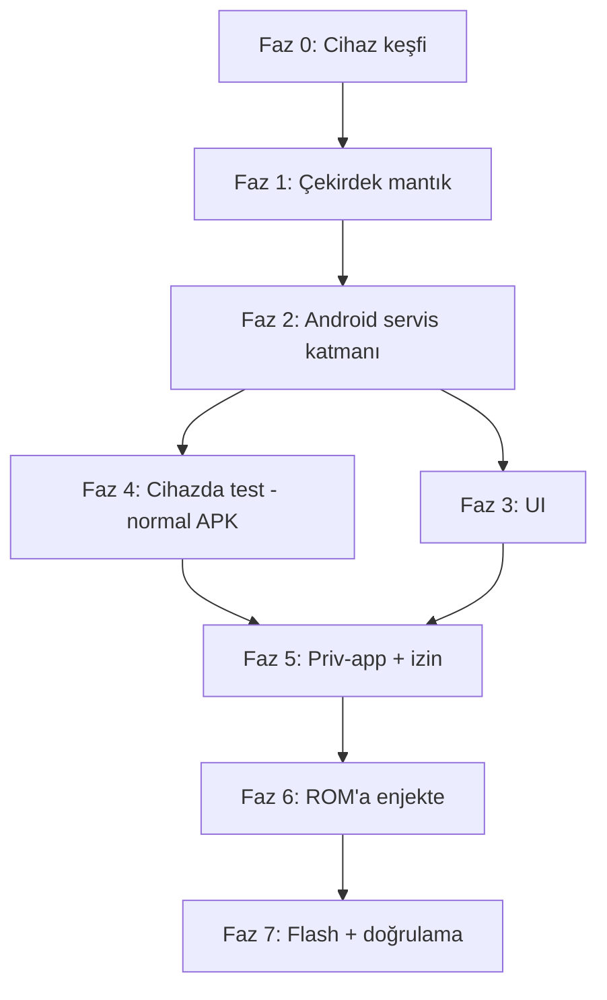

# Dynamic BT - Yapılacaklar Haritası

Hedef: klee / HyperOS 4 (A17) EU ROM'a gömülü priv-app ile whitelist tabanlı dinamik A2DP rate switch.

## Faz 0 - Cihaz keşfi (blokaj çözücü, önce bu)
- [ ] `adb shell dumpsys bluetooth_manager` çıktısı al (LDAC bağlıyken) -> A2DP codec alanları
- [ ] `adb shell dumpsys media.audio_flinger` / `dumpsys audio` örnekleri kaydet
- [ ] Karşı cihazın selectable codec/rate listesini oku
- [ ] Hidden API erişimi: `AudioPlaybackConfiguration.getFormat()` çalışıyor mu
- [ ] Bluetooth audio HAL: AIDL mi, offload var mı (`bt_hybrid_offload` klasörüyle ilişki)
- Çıktı: `docs/device_dumps/` + risk listesinin 1-4. maddelerinin cevabı

## Faz 1 - Çekirdek mantık (cihazsız, birim testli)
- [ ] `CodecCaps`: bitmask <-> Hz/bit, snap, selectable kesişimi
- [ ] `RatePolicy`: whitelist, debounce/hysteresis, cooldown
- [ ] `WhitelistStore`: okuma/yazma (device-protected storage)
- [ ] JUnit testleri (48k default, 44.1/88.2/96k hedef, debounce)

## Faz 2 - Android servis katmanı
- [ ] Gradle modülü (namespace, compileSdk, wrapper), settings/build düzeltmesi
- [ ] `PlaybackMonitor` (AudioPlaybackCallback)
- [ ] `TrackFormatProbe` (A: API, B/C: yedekler)
- [ ] `A2dpController` (proxy, setCodecConfigPreference, doğrulama, cooldown)
- [ ] `UsbController` (durum raporu)
- [ ] `DynamicBtService` + `BootReceiver`

## Faz 3 - UI
- [ ] Durum ekranı (codec, rate, aktif app)
- [ ] Whitelist listesi (kurulu müzik app'leri, aç/kapa, doğru paket adları; Apple Music = com.apple.android.music)
- [ ] Varsayılan profil + enable anahtarı

## Faz 4 - Cihazda test (normal kullanıcı APK, root'suz/KSU ile)
- [ ] Debug APK kur; hangi çağrılar izin yüzünden reddediliyor logla
- [ ] Gerekirse geçici: KSU ile izin ver, davranışı doğrula
- [ ] Rate gerçekten değişiyor mu (`dumpsys bluetooth_manager` + karşı cihaz göstergesi)

## Faz 5 - Priv-app hazırlığı
- [ ] APK imzalama kararı (platform key yok -> privapp allowlist yeter mi test)
- [ ] `privapp-permissions-dynamicbt.xml` finalle
- [ ] SELinux denial'ları (`logcat | grep avc`) -> gerekirse sepolicy kuralı
- [ ] Release APK (R8 kapalı/kurallı), `Android.bp`/prebuilt klasör düzeni (`DynamicBt/DynamicBt.apk`, lib/oat yok)

## Faz 6 - ROM'a enjekte (MIO-KITCHEN)
- [ ] `system_ext.img` aç (`.mio_kitchen_root_bak` çalışma kopyası)
- [ ] `priv-app/DynamicBt/`, `etc/permissions/`, `etc/sysconfig/` ekle
- [ ] `system_ext_file_contexts` / fs_config girişleri (sahiplik, 0644/0755, context)
- [ ] USB XML (`usb_device output` profili) uygula; `direct_pcm` EKLEME
- [ ] Repack (erofs/ext4, orijinal formatla aynı), boyut kontrolü
- [ ] vbmeta: `vbmeta_system` / AVB devre dışı veya yeniden imza stratejisi

## Faz 7 - Flash ve doğrulama
- [ ] Yedek: orijinal `system_ext.img` + `vbmeta*`
- [ ] Fastboot ile flash (`klee_eea_OS4.0.7.0_fastboot` scriptleri)
- [ ] Boot kontrolü, `pm path com.emre.dynamicbt`, izin verildi mi (`dumpsys package`)
- [ ] Uçtan uca test: Poweramp 96k -> LDAC 96k; non-whitelist -> 48k/24
- [ ] Bootloop kurtarma planı hazır (OrangeFox img + orijinal imaj)

## Kritik yol ve sıra
Faz 0 -> 1 -> 2 -> 4 çalışmadan Faz 6'ya geçme. Faz 1 cihazsız paralel yürüyebilir.
Eski dosyalar (daemon, KSU modülü, `dynamic_bt` / `dynamic_bt_whitelist` klasörleri) referans/arşiv; yeni yapıya taşınmaz.
